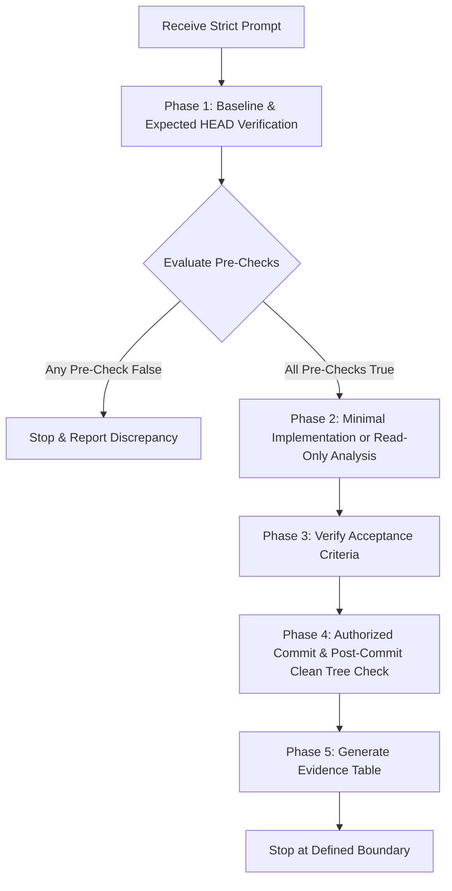

# Strict Coding-Agent Prompts Skill

This skill defines the framework and execution standards for **Strict Coding-Agent Prompts**.
It eliminates agent drift, prevents unintentional modifications, and guarantees verifiable,
audit-ready outcomes through deterministic guardrails.

---

## Core Philosophy

Standard agent prompts often lead to:
- Silent edits to unrelated files.
- Premature scaffolding or speculative implementations.
- Hallucinated verifications (claiming a test or check passed without running it).
- Runaway task execution across unapproved milestones.

A **Strict Coding-Agent Prompt** enforces zero-tolerance boundaries, requiring agents to inspect before modifying, test falsifiable hypotheses, provide empirical command-line evidence, and halt at explicit boundaries.

---

## The 9 Structural Pillars

Every strict prompt must implement the following 9 sections:

### 1. Files Allowlist
- **Rule**: Explicitly enumerate the exact files and directories the agent is permitted to create or modify (or inspect, for read-only tasks).
- **Enforcement**: Zero edits outside the allowlist. If any other file must be touched or inspected, the agent must stop and request explicit user confirmation.
- **Example**:
  ```text
  .agent/
  └── skills/
      └── strict-coding-agent-prompts/
          └── SKILL.md
  ```

### 2. Verify First (Environment Baseline & Expected HEAD)
- **Rule**: Inspect the environment before making any file system or state changes.
- **Expected HEAD Verification**: When working in a Git repository, every implementation prompt must specify the expected starting HEAD commit hash.
  - The agent must run `git rev-parse HEAD` and compare the actual output against the expected hash before modifying any files.
  - If the expected hash is missing, unknown, or does not match, the agent **must STOP and ask for clarification**. Never invent or guess a hash.
  - For non-Git environments, the agent must explicitly report that Git-based verification is unavailable and establish an equivalent environment baseline (e.g., project root, tool versions, directory paths).
- **Checklist**:
  1. Confirm the project root path (`Get-Location` / `pwd`).
  2. Compare the actual Git HEAD commit against the declared expected HEAD.
  3. Inspect the current Git branch and verify clean initial working-tree status (`git status --short`).
  4. Verify whether target allowlist paths already exist.
  5. If a target file exists, do not overwrite unless explicitly instructed.
  6. If the workspace is not a Git repository, report that fact rather than initializing one unilaterally.

### 3. Pre-Checks (Falsifiable Predictions)
- **Rule**: Define two or three explicit, falsifiable hypotheses about the initial environment state.
- **Enforcement**: If any prediction evaluates to false, the agent **must halt immediately** and report the empirical evidence. No silent workarounds or assumptions.

### 4. Minimal Targeted Implementation
- **Rule**: Implement only the minimal deliverable required for the current phase.
- **Constraints**: No speculative helpers, no unrequested boilerplate, no mock tests, and no future-phase scaffolding.
- **Read-Only Tasks**: Analysis and audit prompts must strictly prohibit modifications, patches, or test file creation.

### 5. "Do Not Touch" Guardrails (Task-Specific Tempting Edits)
- **Rule**: State explicit negative constraints to safeguard existing assets and prevent scope creep.
- **Task-Specific Tempting Edits**: Every generated prompt must explicitly identify **two or three tempting adjacent edits** relevant to the specific task (e.g., adding unrequested tests, modifying dependencies/packaging, updating documentation, altering build configurations, or scaffolding a future phase).
- **Protected Areas**:
  - Keep all files and directories outside the allowlist strictly untouched.
  - Existing application code, configuration, and documentation.
  - Unrelated Git branches, tags, remotes, and commit history.

### 6. Acceptance Checklist (Final Tree Verification)
- **Rule**: Define concrete, binary pass/fail verification points.
- **Final Status Rule**:
  - **When a commit is authorized**: The final item of the acceptance checklist must verify that the working tree is completely clean **after the commit** (`git status --short` returns empty).
  - **When no commit is authorized (or read-only)**: The final item must verify that no unauthorized changes, untracked files, or diffs were introduced.
- **Structure**: Markdown task list (`- [ ]`) covering existence, content correctness, exact output testing, diff cleanliness, and post-task working-tree state.

### 7. Commit Requirements & Fresh-Session Rule
- **Rule**: Declare explicit version control boundaries for the task.
- **Fresh-Session Rule**: Every implementation prompt requires **one fresh coding-agent session** to prevent context contamination and hallucinated assumptions from prior tasks.
- **Commit Constraints**:
  - **Single Commit**: Exactly **one commit per implementation prompt**, and only when the prompt explicitly authorizes a commit.
  - **Exact Message**: The commit message must be defined as an exact, verbatim string (e.g., `feat: add hello world script`).
  - **Narrow Staging Scope**: The prompt must enforce staging only the specific allowed files (e.g., `git add path/to/file`), explicitly banning broad staging commands (`git add .` or `git add -A`).
- **Read-Only / Analysis Tasks**: All commits, staging, and pushes are strictly prohibited.

### 8. Empirical Evidence Report
- **Rule**: The agent must present a structured evidence table demonstrating actual execution.
- **Standard**:
  | Check | Verification Command / Method | Actual Evidence | Status (Pass/Fail) |
  |---|---|---|---|
- **Enforcement**: No check may be marked as passed without running a command and capturing verbatim output.

### 9. Explicit Stop Condition
- **Rule**: Define a hard stop boundary.
- **Enforcement**: The agent must stop execution upon fulfilling the acceptance criteria of the current step, rather than autonomously continuing into subsequent phases or creating unrequested fixes.

---

## Standard Prompt Templates

### Template A: Implementation Prompt Template

```markdown
# TASK: [Descriptive Task Title]

[Brief context statement explaining the immediate goal. Requires one fresh coding-agent session.]

## 1. FILES ALLOWLIST
You are allowed to create or modify only:
```text
[Exact directory tree or file paths]
```
Do not create, modify, rename, or delete any other files. If another file must be changed, STOP and explain why.

## 2. VERIFY FIRST
Before making changes:
1. Confirm the project root path (`Get-Location` / `pwd`).
2. Verify the current Git branch (`git branch --show-current`).
3. Verify the expected starting HEAD commit using `git rev-parse HEAD`. Expected HEAD: `[insert exact expected commit hash]`.
   - If the actual HEAD does not match the expected hash, or if the expected hash is missing/unknown, STOP and request clarification. Never invent a hash.
   - For non-Git projects, report that Git verification is unavailable and verify equivalent environment tools.
4. Verify the initial working-tree status is clean (`git status --short`).
5. Inspect whether target allowlist paths already exist. If a target file exists, do not overwrite unless explicitly instructed.

## 3. PRE-CHECKS
Verify these two or three falsifiable predictions before proceeding:
- [Prediction 1, e.g., target file does not yet exist]
- [Prediction 2, e.g., required runtime/interpreter is installed and accessible]
- [Prediction 3, e.g., allowlist encompasses all required changes without conflicting modifications]
If any prediction is false, STOP and report the evidence immediately.

## 4. IMPLEMENTATION PLAN
[Exact scope of work for this phase only]
1. [Step 1: Surgical modification/creation of allowlisted file]
2. [Step 2: Verification of exact output or behavior]
Do not write future-phase scaffolding or unrequested files.

## 5. DO NOT TOUCH
Explicitly do not make these tempting adjacent edits:
1. [Task-specific tempting edit 1, e.g., do not add unrequested unit tests]
2. [Task-specific tempting edit 2, e.g., do not modify packaging/dependencies]
3. [Task-specific tempting edit 3, e.g., do not update documentation or configuration files]
- All existing source code, configuration, Git history, branches, and remotes.

## 6. ACCEPTANCE CHECKLIST
- [ ] [Criterion 1: File created/modified according to specification]
- [ ] [Criterion 2: Exact output or behavior verified]
- [ ] No files outside the allowlist were created or modified.
- [ ] Exactly one commit created staging only the allowlisted file(s).
- [ ] Commit message matches the required string verbatim.
- [ ] Final working tree is clean AFTER the commit (`git status --short` returns empty).

## 7. COMMIT REQUIREMENTS
Run in a fresh coding-agent session. Exactly one commit is authorized:
1. Stage only the allowed file(s):
   ```bash
   git add [path/to/allowed/file]
   ```
   Do not use `git add .` or `git add -A`.
2. Commit with the exact message:
   ```bash
   git commit -m "[exact commit message]"
   ```
Do not push to remotes.

## 8. EVIDENCE REPORT
Return a concise table with:
| Check | Verification Command / Method | Actual Evidence | Status (Pass/Fail) |
|---|---|---|---|
| Project root | `Get-Location` | Verbatim path | |
| Expected HEAD & Branch | `git branch --show-current; git rev-parse HEAD` | Expected SHA matching actual SHA | |
| Initial Git status | `git status --short` | Clean | |
| Exact output verification | `[command to test output]` | Verbatim output | |
| Staged diff | `git diff --cached` | Diff showing only allowlisted changes | |
| Commit log | `git log -1 --oneline` | Verbatim commit hash and message | |
| Post-commit Git status | `git status --short` | Clean (empty) | |

## 9. STOP CONDITIONS
Stop immediately after creating the commit, verifying clean post-commit status, and returning the evidence table. Do not proceed to any subsequent task or add unrequested features.
```

---

### Template B: Read-Only Code-Analysis Prompt Template

```markdown
# TASK: Read-Only Code Analysis of [Component / Feature]

[Brief context statement explaining the analysis goal. This is a strictly read-only inspection.]

## 1. FILES ALLOWLIST
Read-only inspection permitted for:
```text
[Exact directory tree or file paths to inspect]
```
Do not create, modify, rename, delete, stage, commit, or push any files. If additional files must be examined, STOP and report the rationale before proceeding.

## 2. VERIFY FIRST
Before conducting analysis:
1. Confirm the project root path (`Get-Location` / `pwd`).
2. Verify the current Git branch and expected HEAD commit (`git branch --show-current; git rev-parse HEAD`). Expected HEAD: `[insert exact expected commit hash]`.
   - If the actual HEAD does not match the expected hash, STOP and report.
3. Verify that the initial working tree is clean (`git status --short`).
4. Inspect the environment to confirm necessary analysis tools.

## 3. PRE-CHECKS
Verify these two or three falsifiable predictions before proceeding:
- [Prediction 1, e.g., target source files exist within the allowlist and are readable]
- [Prediction 2, e.g., working tree is clean with zero uncommitted modifications]
- [Prediction 3, e.g., analysis can be completed without generating temporary or lock files]
If any prediction evaluates to false, STOP immediately and report the evidence.

## 4. IMPLEMENTATION PLAN (ANALYSIS ONLY)
1. Review target files for security, correctness, error handling, and performance issues.
2. Check edge cases and data validation.
3. Document all findings supported by concrete file paths, line ranges, and severity ratings.
4. Report limitations and unknowns.
Do not write or apply code patches, fixes, or test scripts.

## 5. DO NOT TOUCH
Explicitly do not make these tempting adjacent edits:
1. [Task-specific tempting edit 1, e.g., do not fix discovered bugs or refactor code]
2. [Task-specific tempting edit 2, e.g., do not create test files or repro scripts]
3. [Task-specific tempting edit 3, e.g., do not update documentation or dependencies]
- Strictly prohibit all file edits, staging, commits, and pushes.

## 6. ACCEPTANCE CHECKLIST
- [ ] All inspected files remain unmodified (`git diff` returns empty).
- [ ] No files were created, staged, or committed.
- [ ] Evidence table populated with findings, exact file/line references, severity, and verification methods.
- [ ] Limitations and unknowns are explicitly identified.
- [ ] Final Git working tree confirmed clean (`git status --short` returns empty).

## 7. COMMIT REQUIREMENTS
Strictly read-only. Do not stage files, do not create Git commits, and do not push to remotes.

## 8. EVIDENCE REPORT
Return a structured findings table:
| Finding ID | Title & Description | File & Line Range | Severity (Critical/High/Med/Low) | Verification Method / Evidence |
|---|---|---|---|---|

Additionally report:
- Initial and final Git status (`git status --short`).
- Any limitations or uninspected components.

## 9. STOP CONDITIONS
Stop immediately after delivering the evidence report. Do not create test scripts, do not attempt automated remediation, and do not proceed to another phase without explicit user instructions.
```

---

## Agent Execution Protocol

When an agent receives a strict prompt, it must execute in strict sequential order:



1. **Phase 1: Baseline & Expected HEAD Verification**:
   - Run discovery commands (`Get-Location`, `git status`, `Test-Path`).
   - Run `git rev-parse HEAD` and compare against the declared expected HEAD commit. If mismatched or missing, STOP.
   - Collect raw outputs before performing any mutations or analysis.

2. **Phase 2: Pre-Check Evaluation**:
   - Compare observed reality against prompt predictions.
   - If a conflict occurs, immediately report findings and halt.

3. **Phase 3: Targeted Mutation or Read-Only Analysis**:
   - Touch only allowed paths.
   - For implementation: implement minimal required change without tempting adjacent edits.
   - For analysis: perform read-only inspection without creating patches or files.

4. **Phase 4: Post-Change Verification & Authorized Commit**:
   - Run verification commands (`git diff`, output tests).
   - If a commit is authorized: stage only allowed files, commit with exact message string.
   - Verify working tree is clean **after the commit**.

5. **Phase 5: Evidence Reporting**:
   - Tabulate command outputs and verification evidence.
   - Complete acceptance checklist.

6. **Phase 6: Stop**:
   - Halt execution and await user review.
