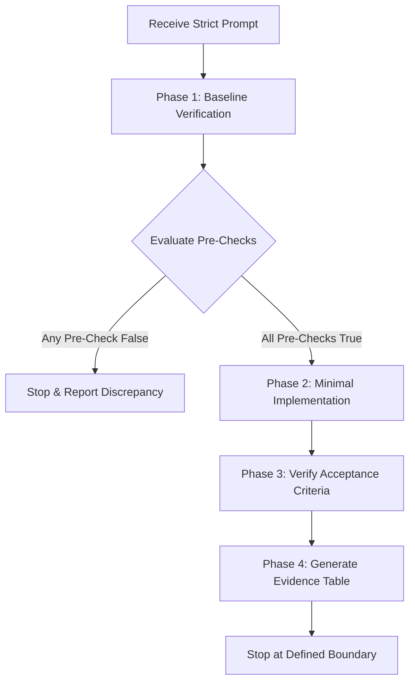

# Strict Coding-Agent Prompts Skill

This skill defines the framework and execution standards for **Strict Coding-Agent Prompts**.
It eliminates agent drift, prevents unintentional modifications, and guarantees verifiable,
audit-ready outcomes through deterministic guardrails.

---

## Core Philosophy

Standard agent prompts often lead to:
- Silent edits to unrelated files.
- Premature scaffolding or speculative implementations.
- Hallucinated verifications (claiming a test or check passed without running it).
- Runaway task execution across unapproved milestones.

A **Strict Coding-Agent Prompt** enforces zero-tolerance boundaries, requiring agents to inspect before modifying, test falsifiable hypotheses, provide empirical command-line evidence, and halt at explicit boundaries.

---

## The 9 Structural Pillars

Every strict prompt must implement the following 9 sections:

### 1. Files Allowlist
- **Rule**: Explicitly enumerate the exact files and directories the agent is permitted to create or modify.
- **Enforcement**: Zero edits outside the allowlist. If any other file must be touched, the agent must stop and request explicit user confirmation.
- **Example**:
  ```text
  .agent/
  └── skills/
      └── strict-coding-agent-prompts/
          └── SKILL.md
  ```

### 2. Verify First (Environment Baseline)
- **Rule**: Inspect the environment before making any file system or state changes.
- **Checklist**:
  1. Confirm the project root path.
  2. Inspect Git branch, HEAD commit, and working-tree cleanliness.
  3. Verify whether target directories or files already exist.
  4. If a target file exists, do not overwrite unless explicitly instructed.
  5. If the repository is not initialized, report the fact rather than making unilateral setup decisions.

### 3. Pre-Checks (Falsifiable Predictions)
- **Rule**: Define explicit hypotheses about the initial environment state.
- **Enforcement**: If any prediction evaluates to false, the agent **must halt immediately** and report the evidence. No silent workarounds.

### 4. Minimal Targeted Implementation
- **Rule**: Implement only the minimal deliverable required for the current phase.
- **Constraints**: No speculative helpers, no unrequested boilerplate, no mock tests, and no future-phase scaffolding.

### 5. "Do Not Touch" Guardrails
- **Rule**: State explicit negative constraints to safeguard existing assets.
- **Protected Areas**:
  - Existing application code and documentation.
  - Project build and configuration files.
  - Unrelated Git branches, tags, remotes, and commit history.

### 6. Acceptance Checklist
- **Rule**: Define concrete, binary pass/fail verification points.
- **Structure**: Markdown task list (`- [ ]`) covering existence, content correctness, diff cleanliness, and Git status.

### 7. Commit Requirements
- **Rule**: Declare explicit version control boundaries for the task.
- **Standard**: For setup or intermediate phases, require "Do not commit" until explicit review. When commits are allowed, specify commit message format and staging scope.

### 8. Empirical Evidence Report
- **Rule**: The agent must present a structured evidence table demonstrating actual execution.
- **Standard**:
  | Check | Evidence |
  |---|---|
  | Project root | Command and verbatim output |
  | Git branch & HEAD | Command and verbatim output |
  | Pre-change status | Command and verbatim output |
  | Created / modified artifacts | Command and verbatim output |
  | Final working tree status | Command and verbatim output |
- **Enforcement**: No check may be marked as passed without running a command and capturing output.

### 9. Explicit Stop Condition
- **Rule**: Define a hard stop boundary.
- **Enforcement**: The agent must stop execution upon fulfilling the acceptance criteria of the current step, rather than autonomously continuing into the next phase.

---

## Standard Prompt Template

Use this template when authoring tasks for coding agents:

```markdown
# TASK: [Descriptive Task Title]

[Brief context statement explaining the immediate goal]

## 1. FILES ALLOWLIST
You are allowed to create or modify only:
```text
[Exact directory tree or file paths]
```
Do not create or modify any other files. If another file must be changed, stop and explain why.

## 2. VERIFY FIRST
Before making changes:
1. Confirm the current project root.
2. Check Git branch, HEAD commit, and working-tree status.
3. Inspect whether target paths exist.
4. If target files already exist, do not overwrite. Stop and report.
5. If the workspace is not a Git repository, report that fact without initializing one.

## 3. PRE-CHECKS
Verify these predictions before proceeding:
- [Prediction 1, e.g., project root is identifiable]
- [Prediction 2, e.g., target file does not yet exist]
- [Prediction 3, e.g., allowlist encompasses all required changes]
If any prediction is false, stop and report the evidence.

## 4. IMPLEMENTATION
[Exact scope of work for this phase only]
Do not write future-phase scaffolding or unrequested files.

## 5. DO NOT TOUCH
- Existing source code, configuration, and documentation.
- Git history, branches, remotes, and unrelated files.

## 6. ACCEPTANCE CHECKLIST
- [ ] [Criterion 1]
- [ ] [Criterion 2]
- [ ] No files outside the allowlist were created or modified.
- [ ] Working tree status is verified.

## 7. COMMIT REQUIREMENTS
[Do not commit in this step / Commit instructions]

## 8. EVIDENCE REPORT
Return a concise table with:
| Check | Evidence |
|---|---|
| Project root | Command and output |
| Git branch and HEAD | Command and output |
| Initial Git status | Command and output |
| Modified / created structure | Command and output |
| Final Git status | Command and output |

## 9. STOP CONDITION
After completing the acceptance criteria, stop. Do not proceed until explicitly instructed.
```

---

## Agent Execution Protocol

When an agent receives a strict prompt, it must execute in strict sequential order:



1. **Phase 1: Baseline Inspection**:
   - Run discovery commands (`Get-Location`, `git status`, `Test-Path`).
   - Collect raw outputs before performing mutations.

2. **Phase 2: Pre-Check Evaluation**:
   - Compare observed reality against prompt predictions.
   - If a conflict occurs, immediately report findings and wait.

3. **Phase 3: Targeted Mutation**:
   - Touch only allowed paths.
   - Implement the minimal required change.

4. **Phase 4: Post-Change Verification**:
   - Run verification commands (`Get-ChildItem`, `git diff`, test suites).
   - Ensure working tree contains zero extraneous modifications.

5. **Phase 5: Evidence Reporting**:
   - Tabulate command outputs.
   - Complete acceptance checklist.

6. **Phase 6: Stop**:
   - Halt execution and await user review.
